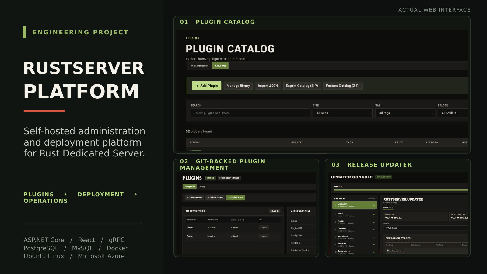
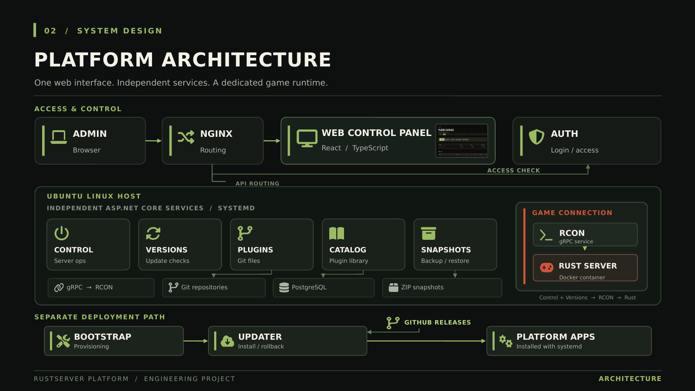
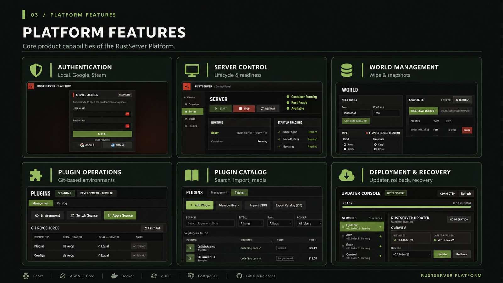
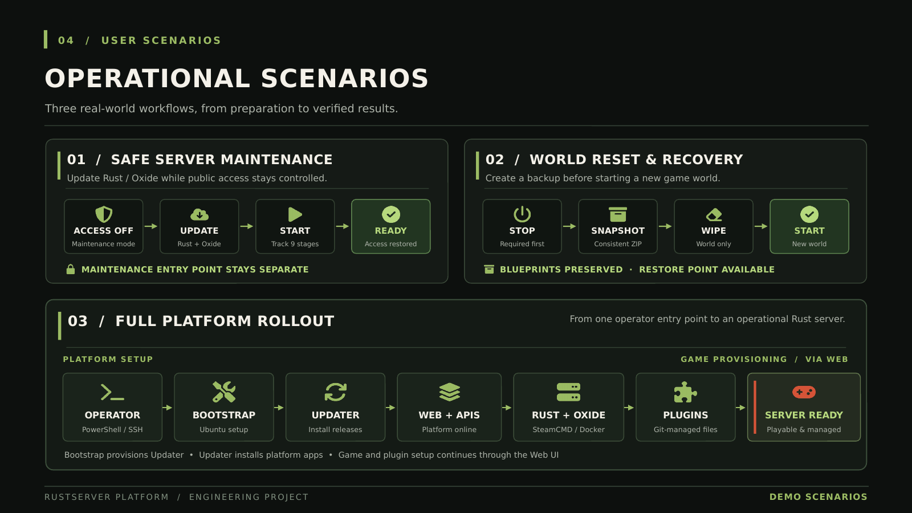
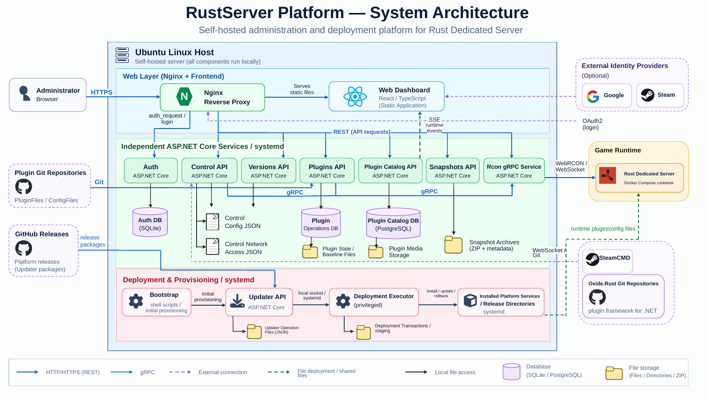

# RustServer Platform

**Self-hosted administration and deployment platform for Rust Dedicated Server.**

A personal engineering project focused on operating a dedicated Rust server through a web interface: lifecycle management, controlled updates, plugin deployment, world backups, and recovery.

**ASP.NET Core · React / TypeScript · gRPC · PostgreSQL · Docker · Ubuntu Linux · GitHub Releases**

[**View presentation ↓**](#project-presentation) · [**Watch demos ↓**](#video-demonstrations) · [**Browse source ↓**](#source-code) · [**Download PowerPoint**](presentation/RustServer_Platform_Complete.pptx)

---

## Project presentation

Four slides covering the platform, its architecture, capabilities, and operational workflows. Select any slide to open its full-size image.

### 01 — Platform overview

A look at the web interface, plugin catalog, Git-backed plugin management, and release updater.

### 02 — Platform architecture

Web access and authentication, independently hosted ASP.NET Core services, Rust game runtime, and the separate bootstrap/update path.

### 03 — Platform features

Authentication, server control, world management, plugin operations, catalog, and deployment/recovery.

### 04 — Operational scenarios

Safe maintenance, world reset with a restore point, and the full platform rollout from bootstrap to an operational server.

[**Download the complete PowerPoint presentation (.pptx)**](presentation/RustServer_Platform_Complete.pptx)

---

## Video demonstrations

Three videos of the project in use. Click a thumbnail to watch on YouTube.

| Demo 01 | Demo 02 | Demo 03 |
| :---: | :---: | :---: |
|  |  |  |
| [Watch video ↗](https://youtu.be/807mv4gjxus) | [Watch video ↗](https://youtu.be/8jmfQ91aiIg) | [Watch video ↗](https://youtu.be/q9CnbNu4yqs) |

---

## Source code

The `source/` directory contains **public snapshots of the platform's source repositories**, grouped by component. Development and deployment continue in separate private repositories; this showcase is intended for browsing and technical review, not as a unified build repository.

| Component | Area |
| --- | --- |
| [RustServer.Auth](source/RustServer.Auth/) | Authentication and access |
| [RustServer.Control](source/RustServer.Control/) | Server lifecycle and operations |
| [RustServer.PluginCatalog](source/RustServer.PluginCatalog/) | Plugin catalog |
| [RustServer.Plugins](source/RustServer.Plugins/) | Git-backed plugin operations |
| [RustServer.Rcon](source/RustServer.Rcon/) | Communication with the Rust game server |
| [RustServer.Snapshots](source/RustServer.Snapshots/) | Backup and restore |
| [RustServer.Updater](source/RustServer.Updater/) | Platform deployment and rollback |
| [RustServer.Versions](source/RustServer.Versions/) | Software version checks |
| [RustServer.Web](source/RustServer.Web/) | React / TypeScript administration UI |
| [rust-server-platform](source/rust-server-platform/) | Platform setup and bootstrap |

> **Note:** The source tree is a publication snapshot, not the original development history. Each component is maintained in its own repository.

---

*RustServer Platform — engineering project and technical showcase.*

---

## Original editable architecture diagram

A detailed architecture diagram of RustServer Platform, available as an image for quick review and as an editable PowerPoint slide.

[**Download the editable architecture diagram (.pptx)**](presentation/RustServer_Architecture_Original_Editable.pptx)
